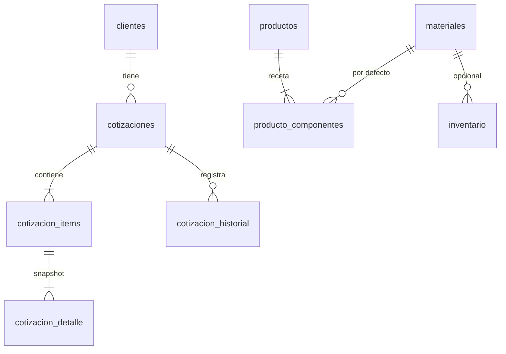

# Diseño técnico

## Arquitectura (monolito modular)
```
Navegador → routes/ (HTTP) → services/ (casos de uso) → engine/ (cálculo puro) + validators/
                                         └→ repositories/ (SQL, sqlite3) → SQLite (instance/cotizador.db)
Vistas:  Flask → plantillas Jinja → HTML/CSS/JS básico → Navegador (sin recursos externos)
```
Reglas: `engine/` no importa Flask ni SQLite y recibe/devuelve datos simples; `routes/` no tiene fórmulas ni SQL;
`repositories/` no tiene fórmulas; el JavaScript no contiene fórmulas.

## Flujo de «Guardar cotización»
1. POST con textos → 2. `validators` (tipos, rangos, existencia) → 3. `services.preparar` arma los componentes desde la receta y los precios
vigentes → 4. `engine.costos.calcular_item` y `engine.precios.calcular_precio` → 5. `repositories.cotizaciones.crear` guarda cabecera,
elementos y detalle en **una transacción** → 6. redirect a la ficha.

## Modelo de datos (resumen)

- Dinero en **centavos enteros**; medidas en **metros** (provisional); porcentajes y cantidades con `Decimal` en el motor.
- `cotizacion_detalle` guarda nombre, cantidad, precio unitario y subtotal usados: cambiar el catálogo no altera cotizaciones guardadas.
- `cotizacion_items.origen_medida` distingue: proporcionada por el cliente / tomada por nosotros / final de fabricación.

## Margen
`recargo_sobre_costo`: precio = costo × (1 + p/100). `margen_sobre_precio`: precio = costo / (1 − p/100). Son distintos (ejemplo con
costo Q1,850 y 30 %: Q2,405.00 frente a Q2,642.86). La base real es **PENDIENTE DE CONFIRMAR**; ambas están implementadas y probadas.
El precio ofertado se reparte entre los elementos en proporción a su costo de materiales.

## Cómo agregar un producto o variante sin reconstruir la aplicación
Un producto es **datos**: una fila en `productos` y filas en `producto_componentes` (etiqueta, rol, categorías de material permitidas,
material por defecto, regla de cantidad, factor, desperdicio). Reglas disponibles: `perimetro`, `area`, `ancho`, `alto`, `fijo`, `por_hoja`.
Ejemplo (en una consola SQLite o un archivo `.sql` de migración):
```sql
INSERT INTO productos (codigo, nombre, categoria, descripcion, estado_datos)
VALUES ('VFI', 'Ventana fija (DEMO)', 'ventana', 'Receta de demostración', 'demostracion');
INSERT INTO producto_componentes (producto_id, etiqueta, rol, categorias_permitidas, material_id, regla, factor, desperdicio_pct, orden)
VALUES ((SELECT id FROM productos WHERE codigo='VFI'), 'Vidrio', 'vidrio', 'vidrio', 2, 'area', 1.0, 10, 1);
```
Solo hace falta código nuevo si aparece un **tipo de regla** nuevo (se agrega en `engine/costos.py` y `catalogos.REGLAS`).
Pantalla para crear productos/componentes: pendiente.

## Diseño propuesto de inventario y sobrantes (siguiente fase)
Hoy: tabla `inventario` manual. Propuesta, porque vidrio y perfil no se representan igual:
- `existencias(material_id, ubicacion, cantidad, unidad)`.
- `sobrantes_lineales` (perfil): material, largo_m, serie, color, ubicación, estado, origen (cotización/trabajo), reutilizable.
- `sobrantes_planos` (vidrio): tipo, espesor, ancho_m, alto_m, ubicación, estado, origen, reutilizable.
- `movimientos_inventario(fecha, tipo [entrada|reserva|salida|baja], material_id, cantidad, referencia)`.

Procedimiento: (1) levantar unidades de compra (largo de barra, medida de plancha) y reglas de consumo/corte con el experto;
(2) migración SQL con las tablas; (3) movimientos manuales con historial; (4) reservar al aprobar una cotización;
(5) descontar solo cuando exista una regla de consumo confirmada; (6) después, evaluar optimización de cortes (1D para perfiles; 2D para vidrio es más difícil).

## Cómo agregar autenticación más adelante
Tabla `usuarios(id, nombre, hash_clave, rol)` · hash con `werkzeug.security` · `session` de Flask · decorador `login_requerido` en
`before_request` · roles (administrador/vendedor) para ocultar costos · CSRF (por ejemplo Flask-WTF `CSRFProtect`) · HTTPS si sale de la red local.
Hasta entonces, `before_request` limita el acceso a 127.0.0.1 (`COTIZADOR_PERMITIR_RED=1` lo desactiva: no hacerlo sin login).

## Seguridad aplicada
Validación en servidor · SQL con `?` · escape de Jinja · claves foráneas (`PRAGMA foreign_keys=ON`) · transacciones · secretos fuera del código
(`SECRET_KEY` por entorno o generado) · BD e `instance/` fuera de Git · versión del cliente sin datos internos · aviso «DEMOSTRACIÓN».
